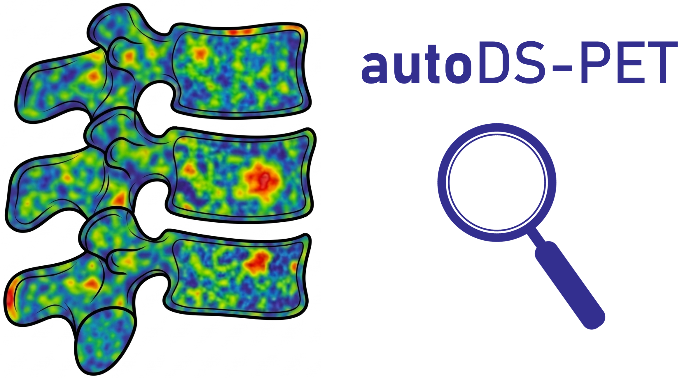

autoDS-PET
==========

**Automatic and semi-automatic Deauville Score computation from PET/CT images.**

autoDS-PET extracts reference uptake values from anatomical ROIs (bone marrow,
mediastinal blood pool, liver, long bones, brain, focal lesions) on
SUV-normalised PET and assigns Deauville Scores by comparing target uptake
against standard thresholds.

.. code-block:: bash

   pip install autods-pet
   autods-pet run -c config.ini -p PATIENT_001

----

.. grid:: 2
   :gutter: 3

   .. grid-item-card:: Getting Started
      :link: getting-started
      :link-type: doc

      Installation, prerequisites, and your first pipeline run.

   .. grid-item-card:: CLI Reference
      :link: cli
      :link-type: doc

      All ``autods-pet`` commands, options, and usage examples.

   .. grid-item-card:: Configuration
      :link: configuration
      :link-type: doc

      INI file parameters for paths, ROIs, erosion, and statistics.

   .. grid-item-card:: Methodology
      :link: methods
      :link-type: doc

      Scientific methods: SUV normalization, registration, ROI extraction, and Deauville scoring.

----

Citation
--------

If you use autoDS-PET in your research, please cite:

   Peluso S, Polizzi S, Pagnini L, Tarozzi M, Rocchi E, Dragonetti V, Solli V, Dall'Olio D, Talarico M, Terragna C, Sala C, Zamagni E, Fanti S, Nanni C, Castellani G.  *Automated Deauville Score computation from baseline [18F]FDG PET/CT predicts progression-free survival in multiple myeloma: a radiogenomic framework.*  European Journal of Nuclear Medicine and Molecular Imaging.  2026.  `doi:10.1007/s00259-026-08103-x <https://doi.org/10.1007/s00259-026-08103-x>`_

.. code-block:: bibtex

   @article{peluso2026autodspet,
     title   = {Automated Deauville Score computation from baseline [18F]FDG PET/CT predicts progression-free survival in multiple myeloma: a radiogenomic framework},
     author  = {Peluso, Sara and Polizzi, Stefano and Pagnini, Lisa and Tarozzi, Martina and Rocchi, Ettore and Dragonetti, Valentino and Solli, Vincenza and Dall'Olio, Daniele and Talarico, Marco and Terragna, Carolina and Sala, Claudia and Zamagni, Elena and Fanti, Stefano and Nanni, Cristina and Castellani, Gastone},
     journal = {European Journal of Nuclear Medicine and Molecular Imaging},
     year    = {2026},
     doi     = {10.1007/s00259-026-08103-x}
   }

Please also cite `TotalSegmentator <https://github.com/wasserth/TotalSegmentator>`_, on which autoDS-PET relies for whole-body CT segmentation.

----

.. toctree::
   :maxdepth: 2
   :hidden:
   :caption: User Guide

   getting-started
   cli
   configuration
   methods

.. toctree::
   :maxdepth: 2
   :hidden:
   :caption: API Reference

   api/index
